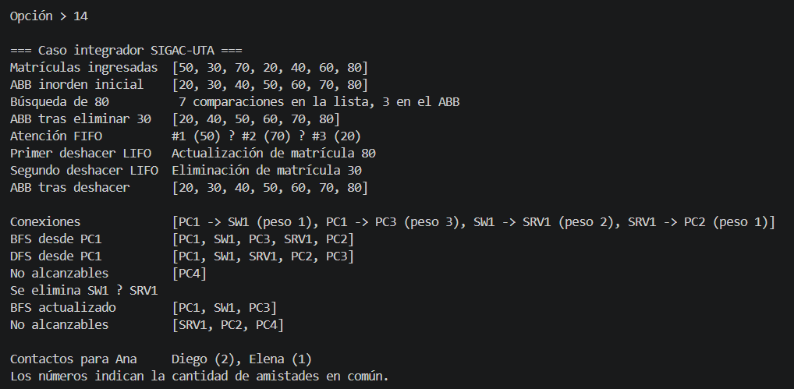

# Matriz de pruebas de SIGAC UTA

Cada caso automatizado inicia con una instancia independiente. Los casos que usan la muestra cargan los datos del examen con `DatosDemostracion.cargar`. Después de compilar el proyecto según el README, ejecuta `java -cp build pruebas.PruebasSIGAC`. El programa muestra el resultado de cada caso y devuelve un código de salida distinto de cero si falla alguna comprobación.

| ID | Módulo | Tipo | Operación comprobada | Resultado esperado |
| --- | --- | --- | --- | --- |
| P01 | M1, M6 | Normal | Cargar la muestra y buscar las matrículas 80 y 99 mediante la lista enlazada y el ABB. | Vector y lista contienen 50, 30, 70, 20, 40, 60 y 80, en ese orden. Para 80 ambas búsquedas devuelven a Gabriela, con 7 comparaciones secuenciales y 3 en el ABB. La matrícula 99 no existe. |
| P02 | M1, M3 | Normal | Registrar al estudiante 11, cambiar su nombre y su ubicación académica, deshacer la edición, editarlo de nuevo y darlo de baja. | El vector, la lista y el ABB reflejan la edición. En la jerarquía, Lucía aparece bajo la carrera Redes. Deshacer recupera la rama original. Tras la baja desaparecen la rama vacía y el estudiante del ABB. |
| P03 | M1, M2 | Extremo | Registrar 35 estudiantes, eliminar el primero y el último, y deshacer ambas bajas. | El vector y la lista crecen, conservan el orden de los 33 restantes y recuperan las 35 posiciones iniciales. |
| P04 | M1, M6 | Erróneo | Intentar altas con matrícula duplicada o cero, nombre en blanco o referencia nula. Editar o eliminar una matrícula ausente y consultar una negativa. | Se rechaza cada operación inválida. Se conserva el registro original y la única operación reversible válida. |
| P05 | M2 | Normal | Encolar tres solicitudes, dos de ellas de la misma matrícula. | Salen en el mismo orden en que se registraron, con los números 1, 2 y 3. Una nueva atención encuentra la cola vacía. |
| P06 | M2, M3 | Normal | Registrar y editar la matrícula 90. Deshacer ambas operaciones. | El primer deshacer recupera el nombre anterior y el segundo retira al estudiante. El historial queda vacío. |
| P07 | M2, M6 | Erróneo | Solicitar laboratorio con matrícula ausente o detalle inválido. Registrar una solicitud válida e intentar eliminar al estudiante o deshacer su alta. | Las entradas inválidas se rechazan. La baja queda bloqueada mientras haya una solicitud pendiente y deshacer vuelve a ser posible tras atenderla. |
| P08 | M3 | Normal | Consultar la jerarquía y los tres recorridos del ABB de la muestra. | La jerarquía contiene Universidad, Facultad, Carrera y estudiantes. El inorden es 20, 30, 40, 50, 60, 70, 80. El preorden es 50, 30, 20, 40, 70, 60, 80. El posorden es 20, 40, 30, 60, 80, 70, 50. |
| P09 | M3 | Extremo | Eliminar la matrícula 30 y después la 50. Ambos nodos tienen dos hijos al momento de la baja. Deshacer las dos operaciones. | El sucesor 40 ocupa la posición de 30. Luego el sucesor 60 ocupa la raíz. El inorden tras las dos bajas es 20, 40, 60, 70, 80. Los dos deshacer recuperan la forma inicial del ABB. |
| P10 | M3 | Extremo | Eliminar una raíz que tiene un solo hijo y, a continuación, el último nodo. | El hijo se convierte en la raíz. La segunda eliminación deja el ABB vacío. |
| P11 | M4 | Normal | Mostrar las aristas ponderadas, ejecutar BFS y DFS desde PC1 y eliminar `SW1 → SRV1`. Consultar también PC2 y PC4. | La arista `SW1 → SRV1` tiene peso 2. BFS recorre PC1, SW1, PC3, SRV1 y PC2. DFS recorre PC1, SW1, SRV1, PC2 y PC3. PC4 es el único equipo inicialmente no alcanzable desde PC1. Tras el corte tampoco se alcanza SRV1 ni PC2. |
| P12 | M4 | Extremo | Recorrer un grafo con un ciclo y rutas convergentes. Eliminar B y volverlo a agregar. | Cada recorrido visita una vez cada equipo alcanzable. La baja de B quita sus dos aristas incidentes. Al reincorporarlo, B queda aislado. |
| P13 | M4, M6 | Erróneo | Agregar un equipo duplicado, nulo o vacío, repetir una arista, usar un peso cero, un origen o un destino inexistente, o borrar una arista inexistente. | Se rechazan las entradas inválidas y se mantienen cuatro aristas. |
| P14 | M5 | Normal | Recomendar amigos para Ana y para un estudiante sin amistades. | Ana recibe a Diego con 2 amigos en común y a Elena con 1, en ese orden. El estudiante sin amigos recibe una lista vacía. |
| P15 | M5, M6 | Extremo y erróneo | Formar un triángulo de amistades, crear dos recomendaciones empatadas, eliminar una amistad y deshacer. Probar amistad consigo mismo, repetida o con matrícula ausente. | No se recomienda al usuario ni a quienes ya son sus amigos. El empate se ordena por matrícula ascendente. Deshacer recupera la recomendación anterior y se rechazan las entradas inválidas. |
| P16 | M1, M2, M3, M5 | Normal | Dar de baja a Beto y recuperar su registro con deshacer. | La baja elimina sus amistades y Diego pasa a tener 1 amistad en común con Ana. Deshacer recupera la posición de Beto en el vector y en la lista, su registro en el ABB y las amistades originales. |
| P17 | M1, M2, M3, M4 | Extremo | Consultar el ABB, el vector, la lista, la cola, la pila y la red al iniciar sin datos. | Las colecciones están vacías, las búsquedas hacen cero comparaciones y la atención y el deshacer no producen resultados. El recorrido rechaza un origen inexistente. |

## Evidencia de ejecución

La ejecución de la suite registró **17 pruebas aprobadas y 0 fallidas**.

- Caso integrador ejecutado en consola.

- Resultados de las pruebas automatizadas.
